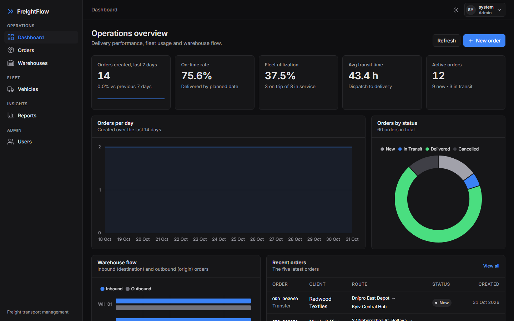
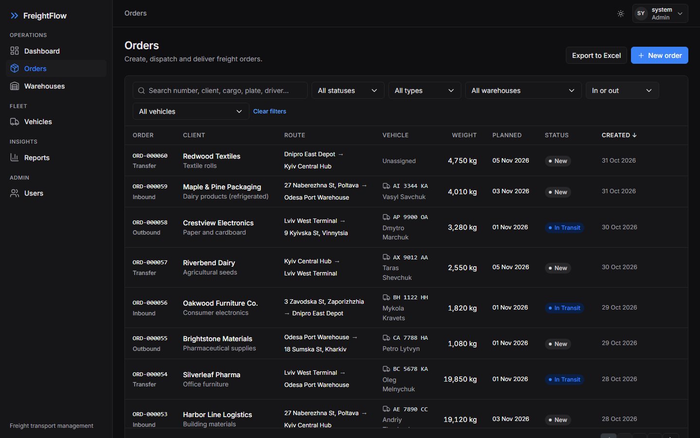
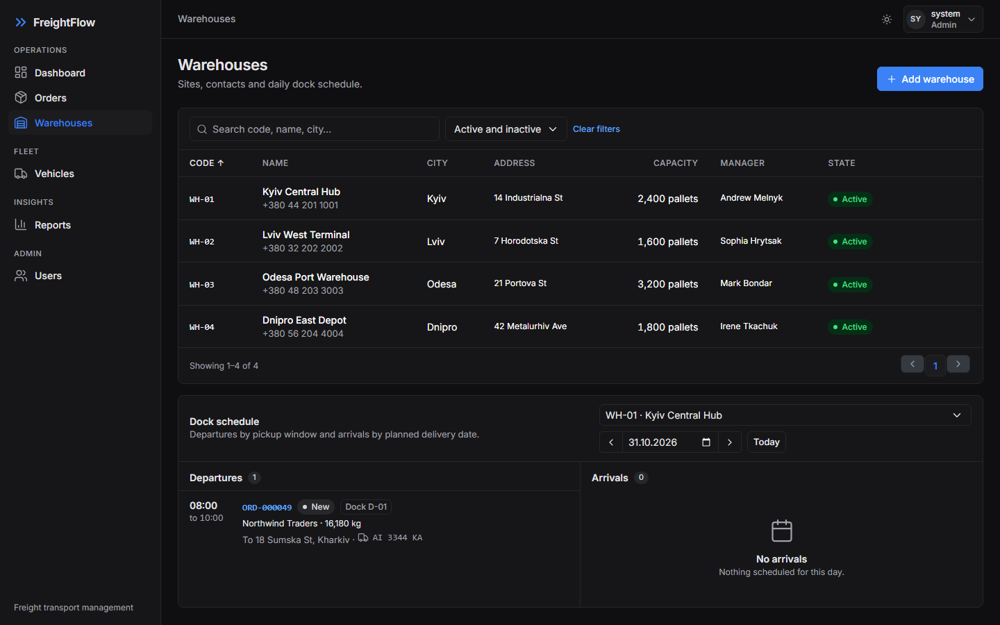
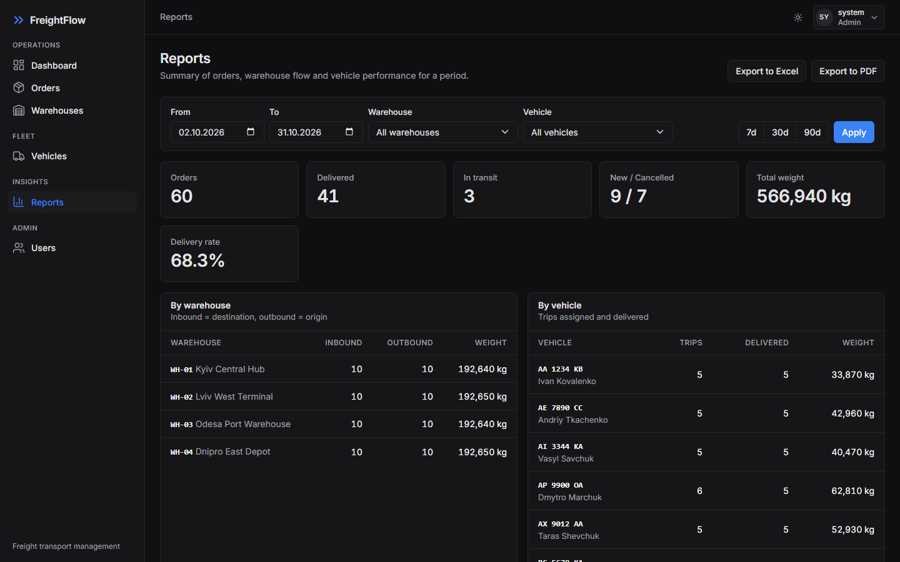
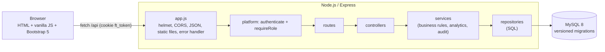

# FreightFlow — Freight Transport Management

A web application for managing freight orders, the vehicle fleet and warehouses of a small logistics company.
Dispatchers create inbound, outbound and transfer orders, assign trucks, track every status change, and capture
proof of delivery (POD). Managers watch KPIs on a dashboard, export reports and review the audit log.

Stack: **Node.js 18+ / Express 4** REST API on **MySQL 8**, and a **vanilla JS + Bootstrap 5** frontend with no build step.

> The binding specification is [`docs/SPEC.md`](docs/SPEC.md). Architecture notes: [`docs/ARCHITECTURE.md`](docs/ARCHITECTURE.md).

---

## Contents

1. [Features](#features)
2. [Screenshots](#screenshots)
3. [Quick start](#quick-start)
4. [Demo accounts](#demo-accounts)
5. [npm scripts](#npm-scripts)
6. [Configuration](#configuration)
7. [Architecture](#architecture)
8. [API reference](#api-reference)
9. [Testing](#testing)
10. [Project structure](#project-structure)
11. [Roadmap](#roadmap)

---

## Features

- **Orders**: inbound / outbound / transfer orders linked to warehouses, auto-generated numbers (`ORD-000123`),
  planned delivery dates, pickup windows and dock numbers.
- **Status workflow**: `New → In Transit → Delivered`, or `Cancelled`; invalid transitions are rejected and
  vehicle states are updated automatically (in one transaction). Every change is recorded in the order history.
- **Proof of delivery**: recipient name, optional drawn signature (PNG) and note.
- **Fleet**: vehicles with driver, capacity and status (Available / On Trip / Maintenance).
- **Warehouses**: master data plus a daily schedule of departures and arrivals per warehouse.
- **Dashboard**: order and fleet counts, on-time delivery rate, fleet utilization, average transit time,
  orders per day (14 days), inbound/outbound per warehouse, recent orders — aggregated in SQL.
- **Reports**: summary by date range, warehouse and vehicle, with CSV export.
- **Audit log**: who created, updated, deleted or changed the status of orders, vehicles, warehouses and users.
- **Users & roles**: cookie-based login; `viewer` (read-only), `dispatcher` (orders and vehicles), `admin` (everything,
  including warehouses, users and the audit log).
- **Security**: scrypt password hashes, signed HttpOnly session cookie, security headers (helmet), login rate limiting,
  CORS restricted to a configured origin.
- Light/dark theme, responsive layout down to 375 px.

## Screenshots

**Dashboard** — on-time rate, fleet utilization, transit time, orders per day and warehouse flow.



**Orders** — server-side search, filters, sorting and pagination; status pills and assigned vehicles.



**Warehouses** — sites and the daily dock schedule (departures by pickup window, arrivals by planned date).



**Reports** — period filters, totals, per-warehouse and per-vehicle breakdowns, PDF and Excel export.



## Quick start

### Prerequisites

- [Node.js 18+](https://nodejs.org)
- [MySQL 8](https://dev.mysql.com/downloads/mysql/) running locally (or reachable), with a user that may create databases

### Steps (any OS)

```bash
cd backend
npm install
cp .env.example .env          # then edit DB_USER / DB_PASSWORD and SESSION_SECRET
npm run db:setup              # creates the database, applies migrations, loads demo data if empty
npm start
```

Open <http://localhost:3000> (or the `PORT` from `.env`) and sign in with a [demo account](#demo-accounts).

On Windows PowerShell use `Copy-Item .env.example .env` instead of `cp`.

### One click (Windows)

After creating `backend/.env`, double-click **`start.bat`**. It installs dependencies on first run, runs
`npm run db:setup`, starts the server and opens the browser on the `PORT` from `backend/.env`.

The server refuses to start (with a clear message) if MySQL is unreachable or migrations are pending — run
`npm run db:setup` again in that case.

## Demo accounts

| Username | Password | Role |
|---|---|---|
| `admin` | `admin123` | admin |
| `dispatcher` | `dispatcher123` | dispatcher |
| `viewer` | `viewer123` | viewer |

Created by the demo seed (`npm run db:setup` on an empty database, or `npm run db:seed`). They are for **demos only** —
delete them or change their passwords before real use.

## npm scripts

Run from `backend/`.

| Script | Description |
|---|---|
| `npm start` | Start the server (`node server.js`) |
| `npm run dev` | Start with auto-reload (nodemon) |
| `npm run db:create` | `CREATE DATABASE IF NOT EXISTS` `DB_NAME` (utf8mb4) |
| `npm run db:migrate` | Apply pending migrations from `database/migrations/` |
| `npm run db:seed` | Load demo data; refuses if data exists unless `-- --force` (wipes tables first) |
| `npm run db:setup` | `db:create` + `db:migrate` + seed if empty (safe to rerun) |
| `npm run db:reset` | Drop and re-create the database with demo data (refused when `NODE_ENV=production`) |
| `npm test` | All tests (Jest + Supertest) against `DB_NAME_TEST` |
| `npm run test:unit` / `test:integration` / `test:platform` | One test group |
| `npm run test:coverage` | All tests with a coverage report |

Append `-- --test` to a `db:*` script to target `DB_NAME_TEST` instead of `DB_NAME`.

## Configuration

Environment variables, read from `backend/.env` (see [`backend/.env.example`](backend/.env.example)):

| Variable | Default | Description |
|---|---|---|
| `PORT` | `3000` | HTTP port |
| `NODE_ENV` | — | `production` requires `SESSION_SECRET`, forbids `AUTH_DISABLED` and `db:reset` |
| `DB_HOST`, `DB_PORT` | `localhost`, `3306` | MySQL server |
| `DB_USER`, `DB_PASSWORD` | `root`, empty | MySQL credentials |
| `DB_NAME` | `freightflow` | Development database |
| `DB_NAME_TEST` | `freightflow_test` | Test database (name must end in `_test`) |
| `SESSION_SECRET` | random at startup (non-production) | Secret for signing session tokens; without it users are logged out on every restart |
| `CORS_ORIGIN` | empty (same-origin only) | Allowed cross-origin frontend URL |
| `AUTH_DISABLED` | `false` | Debugging only: every request acts as an admin. Not allowed in production |

## Architecture



- Layered: `routes → controllers → services → repositories`; dependencies (the MySQL pool, repositories, the audit
  service) are passed in through factories and constructors — no globals.
- `server.js` reads the environment, creates the pool, checks connectivity and migrations, then calls `createApp({ pool, … })`.
  `src/platform.js` provides authentication, users, the audit log, dashboard and reports.
- Dashboard and report aggregates are computed in SQL (`GROUP BY`, conditional `SUM`, UTC day bucketing).
- Errors are thrown as `AppError(code, status, message, details)` and rendered by one error handler as `{ error, message, details? }`.
- Authentication is a stateless HMAC-SHA256 signed token in an HttpOnly cookie; passwords are hashed with scrypt
  (Node's built-in `crypto`).

More detail: [`docs/ARCHITECTURE.md`](docs/ARCHITECTURE.md).

## API reference

Base path `/api`, JSON bodies, authentication via the `ft_token` cookie set by `POST /api/auth/login`.
Errors: `{ "error": "CODE", "message": "...", "details": [{ "field", "message" }] }`.
List endpoints accept `page`, `limit` (max 500), `sort`, `dir` (`asc|desc`), `q` and filters, and return
`{ items, total, page, limit }`.

| Method | Path | Role | Description |
|---|---|---|---|
| GET | `/health` | public | `{ status: "ok", db: "up" }`, or 503 `{ status: "error", db: "down" }` |
| POST | `/auth/login` | public | `{ username, password }` → sets cookie, `{ user }`; 401 bad credentials; 429 after 10 failures / 15 min |
| POST | `/auth/logout` | any | Clears the cookie (204) |
| GET | `/auth/me` | any | Current user |
| GET | `/orders` | viewer | Filters: `status`, `type`, `vehicleId`, `warehouseId` + `direction`, `q` |
| GET | `/orders/:id` | viewer | Order incl. POD signature |
| GET | `/orders/:id/history` | viewer | Status history, oldest first |
| POST | `/orders` | dispatcher | Create (status `new`) |
| PUT | `/orders/:id` | dispatcher | Update editable fields |
| PATCH | `/orders/:id/status` | dispatcher | `{ status, note?, podRecipientName?, podSignature?, podNote? }` |
| DELETE | `/orders/:id` | dispatcher | Delete (only `new` / `cancelled`) |
| GET | `/vehicles`, `/vehicles/:id` | viewer | Filters: `status`, `q` |
| POST / PUT / DELETE | `/vehicles[/:id]` | dispatcher | Manage vehicles |
| GET | `/warehouses`, `/warehouses/:id` | viewer | Filters: `active`, `q` |
| GET | `/warehouses/:id/schedule?date=YYYY-MM-DD` | viewer | Departures and arrivals for a day |
| POST / PUT / DELETE | `/warehouses[/:id]` | admin | Manage warehouses |
| GET | `/dashboard/kpis` | viewer | Dashboard KPIs |
| GET | `/reports/summary` | viewer | Filters: `from`, `to` (YYYY-MM-DD, inclusive), `warehouseId`, `vehicleId` |
| GET / POST | `/users` | admin | List / create users (`{ username, password, role }`) |
| DELETE | `/users/:id` | admin | Delete a user (not yourself) |
| GET | `/audit` | admin | Audit log, newest first. Filters: `entity` (`order|vehicle|warehouse|user`), `entityId`; `page`, `limit` → `{ items, total, page, limit }` |

Audit entries look like
`{ id, userId, username, action: "create|update|delete|status_change", entity, entityId, details, createdAt }`.
Full payload definitions: [`docs/SPEC.md`](docs/SPEC.md) §5–§6, §11.

## Testing

Tests need a running MySQL server (same credentials as in `backend/.env`). They use a **separate test database**,
`DB_NAME_TEST` (default `freightflow_test`), which Jest creates and migrates automatically on every run. The test
tooling refuses any database whose name does not end in `_test`, so your development data is never touched.

```bash
cd backend
npm test                    # everything, in band
npm run test:unit           # unit tests (fakes, no DB access)
npm run test:integration    # domain API and repository tests
npm run test:platform       # auth, users, audit, dashboard and reports
npm run test:coverage       # with coverage report

# use another test database (e.g. one per developer or CI job)
DB_NAME_TEST=freightflow_ci_test npx jest            # macOS / Linux
$env:DB_NAME_TEST="freightflow_ci_test"; npx jest     # Windows PowerShell
```

The project follows TDD: write the failing test first, then the code.

## Project structure

```
freight-transport/
├── start.bat                  # Windows one-click start (needs backend/.env)
├── docs/
│   ├── SPEC.md                # binding specification
│   ├── DESIGN.md              # UI design notes
│   └── ARCHITECTURE.md        # design notes
├── database/
│   └── migrations/            # 001_initial.sql, 002_audit_log.sql, ...
├── backend/
│   ├── server.js              # reads env, checks the DB, starts the app, graceful shutdown
│   ├── scripts/db.js          # npm run db:create|db:migrate|db:seed|db:setup|db:reset
│   ├── src/
│   │   ├── app.js             # createApp({ pool, ... })
│   │   ├── platform.js        # auth, users, audit, dashboard, reports wiring
│   │   ├── errors.js          # AppError
│   │   ├── db/                # pool, transactions, migrations, admin helpers
│   │   ├── auth/              # password hashing, tokens, cookies, middleware, login rate limiter
│   │   ├── domain/            # enums, validation, query parsing
│   │   ├── routes/            # Express routers
│   │   ├── controllers/       # HTTP ↔ service mapping
│   │   ├── services/          # business rules, analytics, audit
│   │   ├── repositories/      # SQL repositories
│   │   ├── middleware/        # error handler, etc.
│   │   └── seed/              # demo data
│   └── tests/
│       ├── unit/  integration/  platform/  db/  frontend/  helpers/
└── frontend/
    ├── pages/                 # login, dashboard, orders, vehicles, warehouses, reports, users
    ├── js/                    # api.js, ui.js, layout.js + one script per page
    └── css/
```

## Roadmap

Ideas for future versions:

- **Customers table** — replace the free-text client name with a managed customer directory.
- **Warehouse stock** — track pallets/stock levels per warehouse driven by inbound and outbound orders.
- **Dock appointments table** — book dock slots per warehouse instead of a free-text dock number.
- **Audit log UI** — browse the audit trail in the frontend.
- **CSV import** — bulk-create orders and vehicles from spreadsheets.
- **Map view** — show pickup/delivery addresses and active trips on a map.
